# Flowdesk 2.0 - Docker Swarm

## Parancsok és működés

A parancsokat a Flowdesk projektmappájában, a VS Code Ubuntu termináljából futtattuk.

### 01. Docker Swarm-szolgáltatások

```bash
sudo docker service ls
```

A Flowdesk három szolgáltatásból áll: Nginx frontend, Flask backend és PostgreSQL-adatbázis. A Swarm a backendből három, a másik két szolgáltatásból egy-egy példányt futtat. A listában 3/3, 1/1 és 1/1 látható.

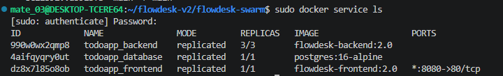

### 02. Docker image-ek

```bash
sudo docker images
```

A frontend és a backend saját Dockerfile-ból épül fel. A flowdesk-frontend:2.0 és flowdesk-backend:2.0 image-ek mellett a PostgreSQL hivatalos 16-alpine verzióját használjuk.

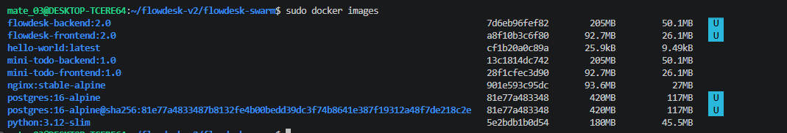

### 03. Overlay hálózatok

```bash
sudo docker network ls
```

A todoapp_webnet köti össze a frontendet a backenddel, a todoapp_dbnet pedig a backendet az adatbázissal. Mindkettő overlay típusú, Swarm által kezelt hálózat.

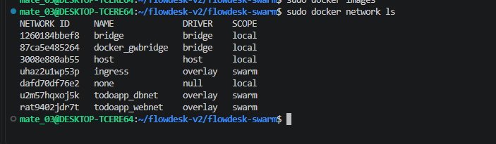

### 04. PostgreSQL-adatkötet

```bash
sudo docker volume ls
```

A PostgreSQL adatait a todoapp_postgres_data nevű Docker volume tárolja. A tároló a konténer újraindítása vagy cseréje után is megmarad.

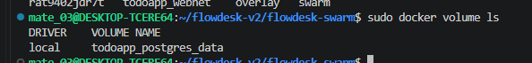

### 05. Adatkötet csatolása

```bash
sudo docker service inspect todoapp_database --format '{{json .Spec.TaskTemplate.ContainerSpec.Mounts}}'
```

A szolgáltatás beállítása alapján a todoapp_postgres_data volume a konténer /var/lib/postgresql/data mappájához van csatolva. A PostgreSQL itt tárolja az adatait.

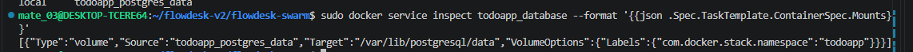

### 06. Backend skálázása: 3 → 5

```bash
sudo docker service scale todoapp_backend=5
```

A Swarm két új backendpéldányt indít a meglévő három mellé. Az öt példány elindult, a szolgáltatás elérte a beállított állapotot.

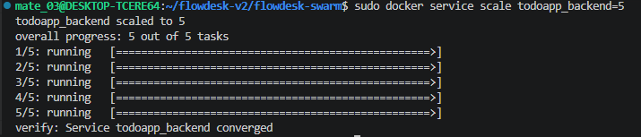

### 07. Öt futó backendpéldány

```bash
sudo docker service ps todoapp_backend
```

Az öt backendfeladat külön konténerként, ugyanazon a Swarm-csomóponton fut. A negyedik és ötödik példány későbbi indulási ideje a skálázás eredménye.

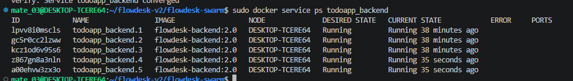

### 08. Backend visszaskálázása: 5 → 3

```bash
sudo docker service scale todoapp_backend=3
```

```bash
sudo docker service ls
```

A backend példányszámát visszaállítottuk háromra. A frontend és az adatbázis továbbra is egy-egy példányban fut.

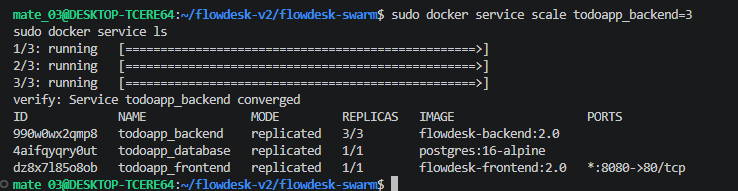

### 09. Futó backendkonténerek

```bash
sudo docker ps --filter "label=com.docker.swarm.service.name=todoapp_backend"
```

A parancs csak a backend szolgáltatáshoz tartozó konténereket listázza. Mindhárom konténer healthy állapotban volt. A konténerazonosítók minden újraindításkor változhatnak.

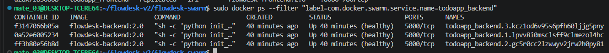

### 10. Konténer leállítása

```bash
sudo docker kill f3147066b05a
```

Egy backendkonténert szándékosan leállítottunk, hogy egy váratlan kiesést szimuláljunk. Az itt látható azonosító az adott teszthez tartozik; megismétléskor az aktuális konténert kell kiválasztani.

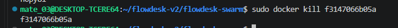

### 11. Automatikus helyreállítás

```bash
sudo docker service ps todoapp_backend
```

```bash
sudo docker service ls
```

A leállított feladat Failed állapotba került, a Swarm pedig új backendfeladatot indított. A szolgáltatás ismét 3/3 példányban fut. Ez konténerkiesés elleni helyreállítás egyetlen csomóponton.

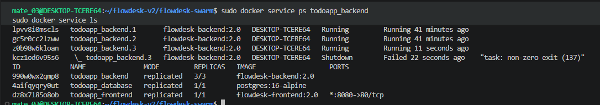

### 12. API és adatbázis kapcsolat

```bash
curl -i --max-time 10 http://127.0.0.1:8080/api/health
```

A kérés az Nginxen keresztül jut el a Flask API-hoz. A válaszban a status és a database mező is ok értéket kapott, tehát a backend és az adatbázis kapcsolata működik.

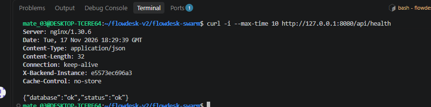

### 13. Mentett feladatok lekérdezése

```bash
curl -s --max-time 10 http://127.0.0.1:8080/api/tasks
```

Az API PostgreSQL-ből olvassa ki a mentett feladatokat, és JSON-formátumban adja vissza őket. A Tanulás és a Tartós adattárolás teszt feladat az újraindítások után is megmaradt.

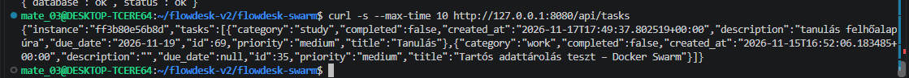

### 14. Cloudflare Tunnel

```bash
cloudflared tunnel --url http://127.0.0.1:8080
```

A Cloudflare Tunnel ideiglenes nyilvános HTTPS-címet biztosít a helyi alkalmazáshoz, routeres porttovábbítás nélkül. A cím csak a tunnel és a gép működése közben érhető el.

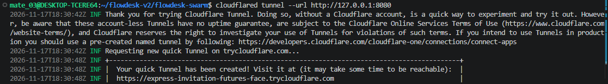

### 15. Nyilvános Flowdesk felület

A Cloudflare által megadott HTTPS-címen megjelent a Flowdesk felület, benne a két korábban elmentett feladattal. A webes felület és az adatlekérdezés interneten keresztül is működött.

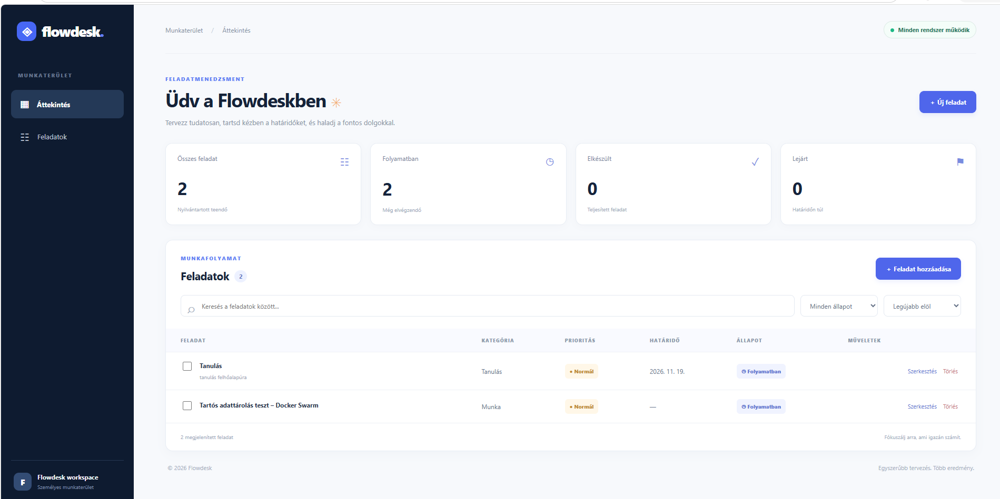

